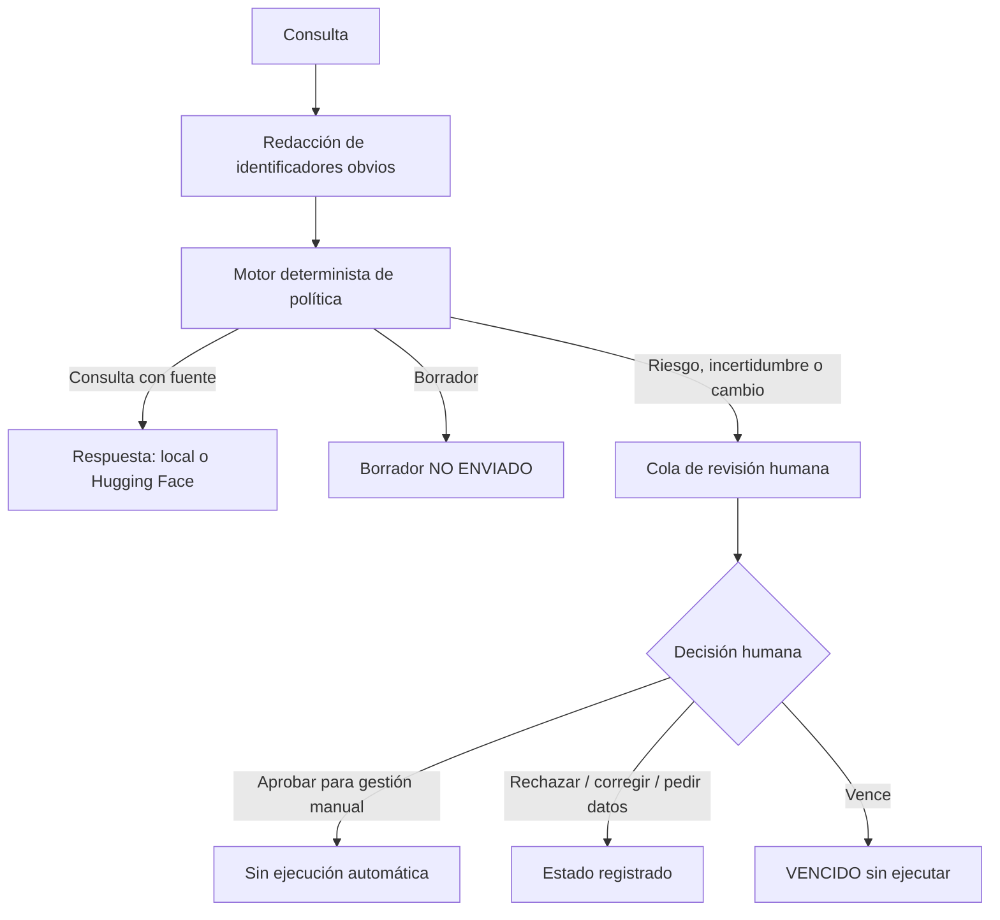

# HITL RR. HH. Harness

**Human-in-the-Loop RRHH - harness**
Es un asistente administrativo de Recursos Humanos que combina reglas deterministas, una skill modular, un modelo opcional de Hugging Face y una cola de revisión humana.

> **Alcance de seguridad:** esta es una demo académica con datos ficticios. No selecciona candidatos, no decide contrataciones/despidos/promociones/sanciones/salarios/evaluaciones, no modifica legajos ni ejecuta acciones externas. La aprobación en la interfaz solo habilita una gestión manual posterior.

## Qué incluye

- `app.py`: interfaz Streamlit con asistente, cola de revisión y auditoría.
- `src/hitl_rrhh/policy.py`: clasificación determinista que decide respuesta automática, borrador, derivación, aprobación o decisión exclusivamente humana. El modelo no puede sobreescribir estas reglas.
- `src/hitl_rrhh/agent.py`: harness que orquesta política, redacción, persistencia y proveedor.
- `src/hitl_rrhh/huggingface_client.py`: adaptador a Hugging Face Inference Providers con token leído desde el entorno.
- `src/hitl_rrhh/store.py`: cola SQLite, vencimiento y auditoría de decisiones sin guardar el texto original completo en los eventos.
- `skills/rrhh-supervision/SKILL.md`: skill modular con metadatos, instrucciones y referencias, inspirada en el patrón de skills del Google ADK.
- `agent.md` y `AGENTS.md`: contrato operativo del agente e instrucciones para agentes de programación.
- `docs/`: política HITL, matriz CSV, diagrama Mermaid y plan de evaluación del sistema.
- `tests/`: pruebas de clasificación, redacción y ciclo HITL.

## Arquitectura



### Decisiones

| Tipo de petición | Tratamiento |
|---|---|
| Pregunta informativa cubierta por una fuente de demostración | Respuesta informativa; identifica que el horario es ficticio |
| Fuente ausente o contradictoria | Deriva a RR. HH. |
| Preparar una solicitud | Solo borrador; no se envía |
| Enviar, aprobar o modificar solicitudes/datos | Caso pendiente de aprobación humana; la demo no integra sistemas externos |
| Contratación, despido, promoción, sanción, salario o evaluación individual | Decisión exclusivamente humana; no se produce ranking ni recomendación sobre la persona |
| Silencio hasta vencer el plazo | Estado `VENCIDO`, sin ejecutar nada |

## Requisitos

- Python 3.11 o superior.
- Un token de Hugging Face solo si se desea probar inferencia remota. Sin token, la demo funciona con respuestas locales de respaldo.

## Instalación local

### Windows (PowerShell)

```powershell
py -3.11 -m venv .venv
.\.venv\Scripts\Activate.ps1
python -m pip install --upgrade pip
pip install -e ".[dev]"
# Alternativa: pip install -r requirements.txt
Copy-Item .env.example .env
```

Abrí `.env` y reemplazá el valor de `HF_TOKEN` por tu token de Hugging Face. No pegues el token en `app.py`, README, capturas o commits. `.env` está excluido por `.gitignore`.

```powershell
streamlit run app.py
```

### Linux / macOS

```bash
python3.11 -m venv .venv
source .venv/bin/activate
python -m pip install --upgrade pip
pip install -e ".[dev]"
# Alternativa: pip install -r requirements.txt
cp .env.example .env
# Editar .env y establecer HF_TOKEN
streamlit run app.py
```

**Modelo:** `HF_MODEL_ID` se puede cambiar por un modelo que esté disponible en Hugging Face Inference Providers para tu cuenta y proveedor. La disponibilidad del modelo/proveedor puede cambiar. Si la llamada falla, se usa un texto local de respaldo y no se ejecuta ninguna acción externa.

## Prueba rápida sugerida

1. Preguntá: `¿Cuál es el horario de atención de RR. HH.?` La respuesta de ejemplo está marcada expresamente como ficticia.
2. Preguntá: `Tengo fuentes en conflicto sobre licencias`. Se crea un caso derivado.
3. Preguntá: `Preparar una solicitud de licencia`. Se crea un borrador `NO ENVIADO`.
4. Preguntá: `Modificar una licencia aprobada`. Se crea un caso pendiente.
5. Preguntá: `¿A quién deberíamos contratar?`. La IA no recomienda una persona; el caso se deriva.
6. En la cola, probá aprobar para gestión manual, rechazar, corregir o pedir información. Nada se envía a un sistema externo.

Para habilitar el modelo remoto, marcá la casilla de confirmación en la interfaz y usá exclusivamente ejemplos ficticios o previamente anonimizados. La redacción de identificadores es limitada y no garantiza eliminar toda la información personal; por eso la regla es no ingresar datos reales.

## Pruebas de calidad

```bash
pytest
ruff check .
```

## Docker (opcional)

```bash
cp .env.example .env
# Editar .env: configurar HF_TOKEN si se usará el proveedor remoto
docker compose up --build
```

La app quedará disponible en `http://localhost:8501`. La carpeta `data/` persiste la cola y la auditoría local.

## Subir a GitHub

```bash
git init
git add .
git status --short   # comprobar que .env NO aparece
git commit -m "feat: prototipo HITL para RRHH con Hugging Face"
git branch -M main
git remote add origin https://github.com/TU-USUARIO/hitl-rrhh-harness.git
git push -u origin main
```

## Limitaciones importantes

- El horario incluido es **ficticio** para la demostración; reemplazarlo por una fuente interna aprobada y versionada.
- No hay autenticación ni permisos por rol. El identificador del revisor es texto libre; no valida identidad.
- SQLite sirve para una demo individual, no para concurrencia ni operación productiva multiusuario.
- La redacción de PII es heurística y parcial; no es DLP.
- No hay integración con un HRIS, correo, nómina, calendario ni sistema de licencias.
- Antes de un piloto real hacen falta revisión legal/privacidad, evaluación de impacto, controles de acceso, seguridad, retención, fuentes con propietario/versión/vigencia, pruebas de sesgo y accesibilidad, y un procedimiento de incidentes.

## Referencias de diseño

- Plan de evaluación y criterios de liberación: `docs/plan-evaluacion.md`.

- Google ADK — Skills para agentes: https://github.com/google/adk-docs/blob/main/docs/skills/index.md
- Google ADK — patrones de workflows y Human-in-the-loop: https://github.com/google/adk-docs/blob/main/docs/workflows/patterns.md
- Hugging Face — Inference Providers: https://huggingface.co/docs/inference-providers/en/index

Este repositorio toma como referencia el patrón de archivos `SKILL.md` y los principios de revisión humana documentados por Google ADK, pero **no depende del runtime de Google ADK**. El harness ejecutable es Python propio, deliberadamente pequeño y comprobable para una entrega de clase.

## Licencia
APACHE — ver `LICENSE`.
